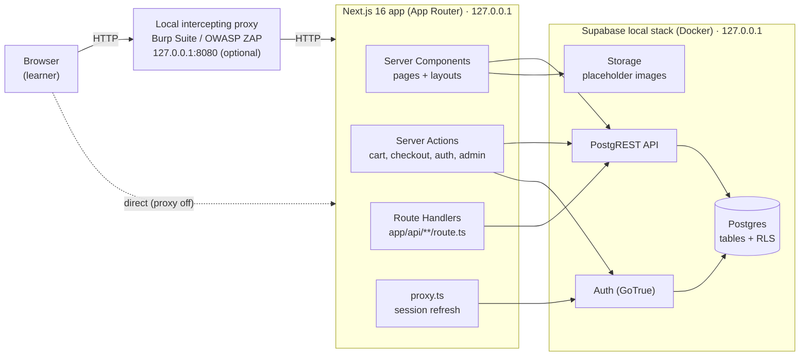

# 00 — Architecture

> **Intentionally vulnerable application — local security training only.**
> (Applies to `vulnerable-lab/`. See [README](README.md#safety-rules-apply-to-every-document-and-every-listing).)

This document fixes the decisions every later phase builds on: the stack, how the pieces talk to each other,
the folder structure of both apps, the shared tooling, and the `.env.local` contract. Later documents may
add files inside this structure but should not change the decisions here without updating this file.

## 1. Architecture diagram



Plain-text version:

```text
Browser ──(optional: Burp / ZAP proxy on 127.0.0.1:8080)──► Next.js app on 127.0.0.1:3000 (secure) / :3001 (lab)
                                                             │  Server Components  → read catalog, cart, orders
                                                             │  Server Actions     → mutate cart, checkout, auth, admin
                                                             │  Route Handlers     → JSON endpoints (search, reviews, admin API)
                                                             │  proxy.ts           → refresh Supabase session cookie
                                                             ▼
                                         Supabase local stack in Docker on 127.0.0.1
                                           Auth (GoTrue) · PostgREST · Postgres (+RLS) · Storage
```

Request flow in one sentence: the browser only talks to Next.js; Next.js talks to Supabase on the server
side using the signed-in user's session (so RLS applies), and uses the secret key only in the seed script.

## 2. Tech stack and rationale

| Layer | Choice | Why |
| --- | --- | --- |
| Framework | **Next.js 16 (App Router) + TypeScript** | One project holds UI and backend (server actions, route handlers). Server-side code is where both the flaws and the fixes live, which keeps lessons readable. |
| UI | **React 19 + Tailwind CSS 4** | Utility classes keep every component self-contained in one listing. Tailwind 4 is configured in CSS (`@theme` in `app/globals.css`), so there is no `tailwind.config` file. |
| Data, auth, storage | **Supabase** (Postgres, Auth, Storage) via `@supabase/supabase-js` + `@supabase/ssr` | Real Postgres with Row Level Security, so authorization lessons (RLS on vs. RLS gaps) are concrete. Runs fully locally with the Supabase CLI. |
| Payments | **None.** Cash on Delivery only | Orders are recorded with `payment_method = 'COD'`. No gateway, no card fields, no payment data anywhere. |
| Testing tools | Burp Suite Community / OWASP ZAP, pointed at `127.0.0.1` | Industry-standard intercepting proxies. Configuration only; covered in `SECURITY-LAB.md` (Phase 6). |

**Lightweight rule:** no state-management libraries, no ORM, no UI kit, no extra auth library. If a later
phase needs a new dependency, it must be added to [§5.2](#52-dependency-list) with a reason.

## 3. Local-first decision

Both apps run entirely on the learner's machine:

- **Supabase runs locally** with the Supabase CLI and Docker Desktop, not as a hosted project. A hosted
  project would make the vulnerable lab's injectable endpoints reachable from the internet, which breaks the
  isolation rule. A hosted project is documented later only as an optional private demo for `secure-main/`.
- **Each app has its own Supabase stack** (its own `supabase/` folder and `project_id`) so the two databases
  never share data and both can run at the same time. The lab's ports are offset by +1000.
- **Next.js binds to `127.0.0.1` explicitly** (`next dev -H 127.0.0.1`), because the default dev server
  listens on all interfaces, which would expose the lab to the local network.

| Service | `secure-main/` | `vulnerable-lab/` |
| --- | --- | --- |
| Next.js | `http://127.0.0.1:3000` | `http://127.0.0.1:3001` |
| Supabase API (Auth, PostgREST, Storage) | `http://127.0.0.1:54321` | `http://127.0.0.1:55321` |
| Postgres | `127.0.0.1:54322` | `127.0.0.1:55322` |
| Supabase Studio | `http://127.0.0.1:54323` | `http://127.0.0.1:55323` |
| Local email inbox (auth emails) | `http://127.0.0.1:54324` | `http://127.0.0.1:55324` |
| Supabase `project_id` | `drippin-secure` | `drippin-lab` |

Every other port in `vulnerable-lab/supabase/config.toml` is also offset by +1000 from the CLI default. The
`config.toml` listings themselves are written in Phase 1; how to confirm nothing listens beyond `127.0.0.1`
is part of the Phase 4 setup checklist.

## 4. Folder structure

Both apps have the **same tree**. The two tables after the tree list every file whose content differs: first
the configuration-only differences (ports, names), then the security controls. Anything in neither table is
byte-for-byte identical between the two apps.

```text
secure-main/                          vulnerable-lab/
├── .env.example                      ├── .env.example
├── package.json                      ├── package.json               (port 3001)
├── next.config.ts                    ├── next.config.ts             (≠ security headers)
├── postcss.config.mjs                ├── postcss.config.mjs
├── tsconfig.json                     ├── tsconfig.json
├── proxy.ts                          ├── proxy.ts
├── app/                              ├── app/
│   ├── layout.tsx                    │   ├── layout.tsx             (≠ renders <LabBanner/>)
│   ├── globals.css                   │   ├── globals.css
│   ├── (shop)/                       │   ├── (shop)/
│   │   ├── page.tsx                  │   │   ├── page.tsx                 landing / hero
│   │   ├── c/[category]/page.tsx     │   │   ├── c/[category]/page.tsx    category listing
│   │   ├── products/page.tsx         │   │   ├── products/page.tsx        (≠ search echo)
│   │   ├── products/[slug]/page.tsx  │   │   ├── products/[slug]/page.tsx (≠ review render)
│   │   ├── checkout/page.tsx         │   │   ├── checkout/page.tsx        COD form
│   │   └── checkout/success/page.tsx │   │   └── checkout/success/page.tsx
│   ├── (auth)/                       │   ├── (auth)/
│   │   ├── login/page.tsx            │   │   ├── login/page.tsx
│   │   └── signup/page.tsx           │   │   └── signup/page.tsx
│   ├── account/                      │   ├── account/
│   │   ├── page.tsx                  │   │   ├── page.tsx
│   │   └── orders/[id]/page.tsx      │   │   └── orders/[id]/page.tsx     (≠ ownership check)
│   ├── admin/                        │   ├── admin/
│   │   ├── layout.tsx                │   │   ├── layout.tsx               (≠ role check)
│   │   ├── page.tsx                  │   │   ├── page.tsx
│   │   ├── products/page.tsx         │   │   ├── products/page.tsx
│   │   ├── categories/page.tsx       │   │   ├── categories/page.tsx
│   │   ├── orders/page.tsx           │   │   ├── orders/page.tsx
│   │   └── users/page.tsx            │   │   └── users/page.tsx
│   └── api/                          │   └── api/
│       ├── products/route.ts         │       ├── products/route.ts        (≠ SQL injection)
│       └── products/exists/route.ts  │       └── products/exists/route.ts (≠ blind SQL injection)
├── components/                       ├── components/              (same subfolders in both apps)
│   ├── layout/  (Navbar, SlideOutMenu, Footer)
│   ├── home/    (Hero, PromoSection, FeaturedGrid)
│   ├── product/ (ProductCard, ProductGrid, Filters, SearchBar, Gallery, BuyPanel, SizePills, Reviews, DetailAccordion)
│   ├── cart/    (CartDrawer, CartLine)
│   ├── checkout/(CodCheckoutForm)
│   ├── auth/    (LoginForm, SignupForm, GuestEntry)
│   ├── admin/   (AdminShell, DataTable, EntityForm)
│   └── —                             │   └── lab/LabBanner.tsx      (lab only)
├── public/images/                    ├── public/images/           generated SVG placeholders
├── lib/                              ├── lib/
│   ├── supabase/                     │   ├── supabase/
│   │   ├── client.ts                 │   │   ├── client.ts        browser client
│   │   ├── server.ts                 │   │   ├── server.ts        server client (user session)
│   │   └── admin.ts                  │   │   └── admin.ts         secret key, seed script only
│   ├── actions/                      │   ├── actions/
│   │   ├── auth.ts                   │   │   ├── auth.ts          (≠ no rate limit / lockout)
│   │   ├── cart.ts                   │   │   ├── cart.ts
│   │   ├── checkout.ts               │   │   ├── checkout.ts      (≠ trusts client price, optional)
│   │   ├── reviews.ts                │   │   ├── reviews.ts       (≠ stores raw HTML)
│   │   └── admin.ts                  │   │   └── admin.ts
│   ├── security/rate-limit.ts        │   ├── —                    (secure only)
│   ├── types.ts                      │   ├── types.ts
│   └── —                             │   └── lab/local-only-guard.ts (lab only)
├── scripts/seed.ts                   ├── scripts/seed.ts
└── supabase/                         └── supabase/
    ├── config.toml                       ├── config.toml          (≠ ports, project_id)
    ├── migrations/                       ├── migrations/
    │   ├── 0001_…0006_*.sql  (shared)    │   ├── 0001_…0006_*.sql (shared, identical)
    │   ├── 0007_rls_policies.sql         │   ├── 0007_rls_policies.sql (≠ intentional gaps)
    │   └── —                             │   └── 9001_lab_only_unsafe_functions.sql (lab only)
    └── seed.sql                          └── seed.sql
```

The exact file names inside `components/`, `lib/actions/` and `supabase/migrations/` may be refined by the
phase that writes them; the rule that the trees match and only the files below differ is fixed.

### Files that differ for configuration only (not lessons)

| File | What differs | Phase written |
| --- | --- | --- |
| `package.json` | `name`, and the dev port (`3000` vs. `3001`). Dependencies are identical. | 2 |
| `.env.example` | Port numbers and `NEXT_PUBLIC_LAB_MODE` (see [§5.3](#53-envlocal-contract)) | 2 |
| `supabase/config.toml` | `project_id`, ports offset by +1000, and Supabase Auth's built-in rate limits raised in the lab ([§7](#7-decisions-carried-into-later-phases)) | 1 |

### Files that differ (the security controls)

| File | `secure-main/` | `vulnerable-lab/` | Lesson | Phase written |
| --- | --- | --- | --- | --- |
| `lib/actions/auth.ts` | Rate limit + lockout, generic error messages, audit log entry | No limit, distinct "no such user" vs. "wrong password" errors | Authentication brute force | 3 / 5 |
| `app/api/products/route.ts` + lab-only SQL function | Supabase query builder (parameterized) | `supabase.rpc()` into a function that concatenates the search term into `EXECUTE` | SQL injection | 3 / 5 |
| `app/api/products/exists/route.ts` + lab-only SQL function | Query builder | Same unsafe function, response only says true/false | Blind SQL injection | 3 / 5 |
| `app/(shop)/products/page.tsx` | Search term rendered as React text | Search term rendered with `dangerouslySetInnerHTML` | Reflected XSS | 2 / 5 |
| `lib/actions/reviews.ts` + review render | Plain-text reviews, length limit, CSP | Raw HTML stored and rendered | Stored XSS | 3 / 5 |
| `supabase/migrations/0007_rls_policies.sql`, `account/orders/[id]`, `admin/layout.tsx` | RLS on every table + server-side ownership and role checks | Documented gaps (optional extensions) | Broken access control, IDOR | 1 / 5 |
| `lib/actions/checkout.ts` | Prices and totals recomputed on the server | Client-sent price trusted (optional extension) | Price / quantity manipulation | 3 / 5 |
| `next.config.ts` | Security headers + CSP | Headers removed (optional extension) | Missing security headers | 3 / 5 |
| `app/layout.tsx`, `components/lab/LabBanner.tsx`, `lib/lab/local-only-guard.ts` | Not present | Persistent banner; refuses to start unless Supabase URL and app host are loopback | Guardrail, not a lesson | 5 |

**How SQL injection is possible with Supabase:** the Supabase JS query builder always parameterizes, so the
vulnerable lab cannot get string-built SQL from it. Instead, the lab adds one migration that exists **only in
`vulnerable-lab/`** (`9001_lab_only_unsafe_functions.sql`) defining a Postgres function that builds a query by
string concatenation and runs it with `EXECUTE`. The route handler calls it through `supabase.rpc()`. This
keeps both apps on the same dependencies, and keeps the unsafe code out of `secure-main/` and out of anything
deployable. Full listings: Phase 5.

## 5. Shared tooling

### 5.1 Prerequisites (Windows-friendly)

| Tool | Version | Notes |
| --- | --- | --- |
| Node.js | **24 LTS** (minimum 22.18) | Node 22.18+ runs `.ts` files directly, so `scripts/seed.ts` needs no extra runner. Next.js 16 requires ≥ 20.9. |
| npm | Ships with Node (11.x) | The guide uses npm only. |
| Docker Desktop | Current, WSL 2 backend | Hosts the local Supabase stack. Must be running before `supabase start`. |
| Supabase CLI | 2.120.0, installed **per app as a dev dependency** | Run as `npx supabase …`. No global install, no Scoop needed. |
| Git | Any recent | Git Bash is the shell used in command blocks. |
| Burp Suite Community or OWASP ZAP | Current | Only needed from Phase 6 onward. |

Full step-by-step install and run instructions are in `05-local-setup.md` (Phase 4).

### 5.2 Dependency list

Identical in both apps. Versions are pinned exactly (no `^`) so the two apps can never drift apart; they
were checked against the npm registry on 2026-10-11. The complete `package.json` listings are written in
Phase 2.

| Package | Version | Kind | Purpose |
| --- | --- | --- | --- |
| `next` | 16.4.0 | runtime | Framework |
| `react`, `react-dom` | 19.3.0 | runtime | UI |
| `@supabase/supabase-js` | 2.117.3 | runtime | Database, auth, storage client |
| `@supabase/ssr` | 0.12.7 | runtime | Cookie-based Supabase sessions in server code |
| `typescript` | 5.9.3 | dev | Type checking. Held on 5.x; TypeScript 7 is newer but not adopted until Next.js tooling is confirmed compatible |
| `@types/react`, `@types/react-dom` | 19.3.0 | dev | Types |
| `@types/node` | 24.19.2 | dev | Types matching Node 24 |
| `tailwindcss`, `@tailwindcss/postcss` | 4.3.3 | dev | Styling |
| `supabase` | 2.120.0 | dev | Supabase CLI (`npx supabase start`, `db reset`, `status`) |

Deliberately **not** included: ESLint (optional; adds config surface for beginners), state libraries, ORMs,
UI kits, HTML sanitizers (`secure-main/` renders user text as plain text, so React's escaping is the control),
and payment SDKs. Playwright may be added as an optional dev dependency in Phase 6 for the lab-only
verification tests.

Planned npm scripts (finalized with `package.json` in Phase 2):

```bash
npm run dev        # next dev -H 127.0.0.1 -p 3000   (lab: -p 3001)
npm run db:start   # supabase start
npm run db:reset   # supabase db reset   (re-applies migrations + seed.sql)
npm run seed       # node scripts/seed.ts   (creates auth test accounts)
```

### 5.3 `.env.local` contract

Each app reads its own `.env.local`, created by copying that app's `.env.example`. `.env.local` is git-ignored
(see the repository's root `.gitignore`) and is never committed. Values come from `npx supabase status`
after `npx supabase start`; the local keys are generated by the CLI for the local stack only and are not
secrets of any real project.

| Variable | Exposed to browser | `secure-main/` value | `vulnerable-lab/` value | Used by |
| --- | --- | --- | --- | --- |
| `NEXT_PUBLIC_SUPABASE_URL` | yes | `http://127.0.0.1:54321` | `http://127.0.0.1:55321` | All Supabase clients |
| `NEXT_PUBLIC_SUPABASE_PUBLISHABLE_KEY` | yes | Publishable (or legacy anon) key from `supabase status` | Same, from the lab's stack | Browser + server clients (RLS applies) |
| `SUPABASE_SECRET_KEY` | **no** | Secret (or legacy service_role) key from `supabase status` | Same, from the lab's stack | `lib/supabase/admin.ts`, used **only** by `scripts/seed.ts` |
| `NEXT_PUBLIC_SITE_URL` | yes | `http://127.0.0.1:3000` | `http://127.0.0.1:3001` | Auth redirects, absolute links |
| `NEXT_PUBLIC_LAB_MODE` | yes | `secure` | `vulnerable` | Banner, local-only guard |
| `LOGIN_MAX_ATTEMPTS` | no | `5` | unset (control removed) | `lib/security/rate-limit.ts` |
| `LOGIN_LOCKOUT_MINUTES` | no | `15` | unset (control removed) | `lib/security/rate-limit.ts` |

Rules:

- Anything prefixed `NEXT_PUBLIC_` is bundled into browser JavaScript. Never put a secret there.
- `SUPABASE_SECRET_KEY` bypasses RLS. It is never imported by pages, actions or route handlers, only by the
  seed script.
- Test-account passwords are **not** environment variables; they are documented lab-only placeholders in
  `02-seed-data.md` (Phase 1).
- If `NEXT_PUBLIC_LAB_MODE=vulnerable`, the local-only guard (Phase 5) refuses to run unless
  `NEXT_PUBLIC_SUPABASE_URL` and `NEXT_PUBLIC_SITE_URL` point at `127.0.0.1` or `localhost`.

## 6. The safety banner

Exact text, never reworded:

> **Intentionally vulnerable application — local security training only.**

- Rendered by `vulnerable-lab/components/lab/LabBanner.tsx` from `vulnerable-lab/app/layout.tsx`, so it is on
  every page including admin and error pages. Fixed to the top of the viewport, high-contrast, not dismissible.
- `secure-main/` does not show this banner (it has no intentional flaws). Its footer carries a small
  "Local training reference build" note instead.
- The same sentence heads every document in `docs/` that discusses the lab, and the
  `vulnerable-lab/README.md` file.

## 7. Decisions carried into later phases

| Topic | Decision | Owner phase |
| --- | --- | --- |
| `users` table vs. Supabase Auth | `public.users` is a profile table keyed to `auth.users.id` (role, display name, contact). Credentials stay in Supabase Auth. | 1 |
| Guest checkout | Guest orders store delivery contact on the order with `user_id = null`; a guest cart is keyed by an httpOnly cookie id. | 1 / 3 |
| Brute-force control storage | Failed-login counts are derived from `audit_logs` rows, so no eleventh table is needed. | 1 / 3 |
| Supabase's own auth rate limits | The local `config.toml` raises Supabase Auth's built-in limits in the lab so the app-level lesson is observable; `secure-main/` keeps them. | 1 / 5 |
| Product images | Locally generated SVG placeholders under `public/images/` (no Storage upload needed for seed data). | 1 |
