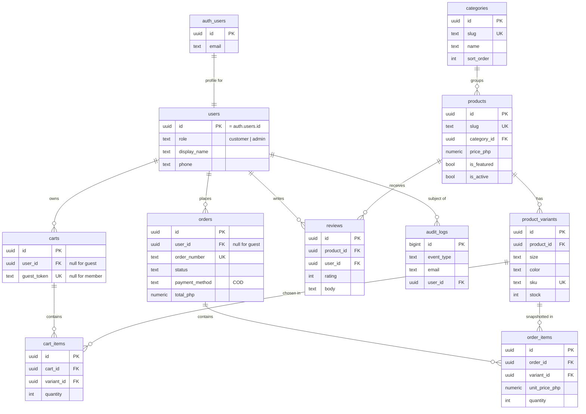

# 01 — Database

> **Intentionally vulnerable application — local security training only.**
> (Applies to `vulnerable-lab/`. See [README](README.md#safety-rules-apply-to-every-document-and-every-listing).)

This document defines the data layer that **both** apps share: the ten tables, their relationships, the
`supabase/config.toml` for each app, the migration SQL (`0001`–`0007`), and the Row Level Security (RLS)
posture. Everything here is written once and copied into both `secure-main/supabase/` and
`vulnerable-lab/supabase/` — the only database file that differs is `0007_rls_policies.sql` (the lab's gapped
version and its lab-only unsafe function are written in Phase 5, see
[`00-architecture.md` §4](00-architecture.md#files-that-differ-the-security-controls)).

Seed data (products, test accounts, placeholder images) is in [`02-seed-data.md`](02-seed-data.md).

## 1. The ten tables at a glance

| # | Table | Holds | Keyed to |
| --- | --- | --- | --- |
| 1 | `public.users` | Profile + role for each account (not credentials) | `auth.users.id` |
| 2 | `public.categories` | The three shop categories | — |
| 3 | `public.products` | One row per product | `categories` |
| 4 | `public.product_variants` | Size + colour + stock + SKU per product | `products` |
| 5 | `public.carts` | One open cart per user or per guest token | `users` (nullable) |
| 6 | `public.cart_items` | Lines inside a cart | `carts`, `product_variants` |
| 7 | `public.orders` | A placed COD order | `users` (nullable for guests) |
| 8 | `public.order_items` | Lines inside an order (snapshotted) | `orders`, `product_variants` |
| 9 | `public.reviews` | Product reviews | `products`, `users` |
| 10 | `public.audit_logs` | Security events incl. login attempts | `users` (nullable) |

Credentials (email, password hash, session) live in Supabase Auth's own `auth.users` table, which the app
never writes to directly. `public.users` is a **profile** table: it carries the role and display fields and is
created automatically when an `auth.users` row appears (migration `0001`). This is the decision fixed in
[`00-architecture.md` §7](00-architecture.md#7-decisions-carried-into-later-phases).

## 2. Entity-relationship diagram



Relationships in prose:

- Each **category** groups many **products**; each **product** has many **variants** (a size + colour
  combination with its own stock count and SKU).
- A **cart** belongs either to a member (`user_id`) or to a guest (`guest_token` from an httpOnly cookie) —
  never both, never neither. Its **cart_items** each point at a variant.
- An **order** belongs to a member or a guest. Its **order_items** copy the product name, size, colour and
  price at purchase time (a *snapshot*), so later catalogue edits never rewrite order history.
- **Reviews** belong to a product and (optionally) to the member who wrote them.
- **audit_logs** records security events — successful and failed logins, order creation, admin actions — and
  is the source the secure app counts failed logins from (no separate "login attempts" table).

## 3. Per-app `supabase/config.toml`

Both apps keep the `config.toml` that `npx supabase init` generates. Only the fields below are edited; every
other field stays at the CLI default. The two apps differ only in `project_id` and in ports (the lab is
offset by **+1000**) plus one deliberate auth-limit change in the lab, so the two local stacks can run at the
same time without colliding. Writing out the full ~200-line generated file in both places would add no
teaching value and would drift from whatever the installed CLI emits, so only the edits are listed.

**`secure-main/supabase/config.toml`** (edited fields):

```toml
project_id = "drippin-secure"

[api]
port = 54321

[db]
port = 54322

[studio]
port = 54323

[inbucket]
port = 54324

# Supabase Auth's own brute-force protection is LEFT AT DEFAULT in secure-main.
# The app adds its own rate limit + lockout on top (lib/security/rate-limit.ts).
```

**`vulnerable-lab/supabase/config.toml`** (edited fields):

```toml
project_id = "drippin-lab"

[api]
port = 55321

[db]
port = 55322

[studio]
port = 55323

[inbucket]
port = 55324

# INTENTIONAL (lab only): Supabase Auth's built-in rate limit is raised so the
# APP-LEVEL brute-force lesson is observable instead of being masked by the
# platform. This is a config change, not a code vulnerability; the real lesson
# lives in vulnerable-lab/lib/actions/auth.ts (Phase 5).
[auth.rate_limit]
sign_in_sign_ups = 1000
```

> Binding to loopback: the Supabase CLI already serves these on `127.0.0.1`. Next.js is bound explicitly with
> `next dev -H 127.0.0.1` (Phase 2's `package.json`). Confirming nothing listens beyond loopback is part of
> the Phase 4 checklist.

## 4. Migrations

Files live in `supabase/migrations/` and run in filename order on `npx supabase db reset`. Migrations
`0001`–`0007` are **identical in both apps** as written here. In Phase 5 the lab replaces its own copy of
`0007` with a gapped version and adds a lab-only `9001_lab_only_unsafe_functions.sql`; nothing in this
document is unsafe.

### `supabase/migrations/0001_users_and_profile.sql`

```sql
-- 0001_users_and_profile.sql
-- Profile table mirroring auth.users, plus the trigger that creates a profile
-- row whenever Supabase Auth creates an account. Credentials never live here.

create type public.user_role as enum ('customer', 'admin');

create table public.users (
  id           uuid primary key references auth.users (id) on delete cascade,
  email        text not null,
  display_name text not null default 'Shopper',
  phone        text,
  role         public.user_role not null default 'customer',
  created_at   timestamptz not null default now()
);

comment on table public.users is 'Profile + role for each auth.users account. No credentials.';

-- Create a profile row for every new auth user. display_name/phone come from the
-- metadata the signup action sets; role always starts as customer (admins are
-- promoted explicitly by the seed script or an existing admin).
create function public.handle_new_user()
returns trigger
language plpgsql
security definer
set search_path = ''
as $$
begin
  insert into public.users (id, email, display_name, phone)
  values (
    new.id,
    new.email,
    coalesce(nullif(new.raw_user_meta_data ->> 'display_name', ''), 'Shopper'),
    nullif(new.raw_user_meta_data ->> 'phone', '')
  );
  return new;
end;
$$;

create trigger on_auth_user_created
  after insert on auth.users
  for each row execute function public.handle_new_user();

-- Keep the email mirror in sync if it changes in Auth.
create function public.handle_user_email_change()
returns trigger
language plpgsql
security definer
set search_path = ''
as $$
begin
  update public.users set email = new.email where id = new.id;
  return new;
end;
$$;

create trigger on_auth_user_email_changed
  after update of email on auth.users
  for each row execute function public.handle_user_email_change();
```

### `supabase/migrations/0002_catalog.sql`

```sql
-- 0002_catalog.sql
-- Categories, products, and per-size/colour variants with stock.

create table public.categories (
  id          uuid primary key default gen_random_uuid(),
  slug        text not null unique,
  name        text not null,
  description text not null default '',
  sort_order  int  not null default 0,
  created_at  timestamptz not null default now()
);

create table public.products (
  id          uuid primary key default gen_random_uuid(),
  slug        text not null unique,
  category_id uuid not null references public.categories (id) on delete restrict,
  name        text not null,
  description text not null default '',
  price_php   numeric(10,2) not null check (price_php >= 0),
  currency    text not null default 'PHP' check (currency = 'PHP'),
  image_path  text not null default '',          -- e.g. /images/alon-oversized-tee.svg
  is_featured boolean not null default false,
  is_active   boolean not null default true,
  created_at  timestamptz not null default now()
);

create table public.product_variants (
  id         uuid primary key default gen_random_uuid(),
  product_id uuid not null references public.products (id) on delete cascade,
  size       text not null,
  color      text not null,
  sku        text not null unique,
  stock      int  not null default 0 check (stock >= 0),
  created_at timestamptz not null default now(),
  unique (product_id, size, color)
);

create index products_category_id_idx on public.products (category_id);
create index products_is_featured_idx on public.products (is_featured) where is_featured;
create index products_is_active_idx   on public.products (is_active);
create index product_variants_product_id_idx on public.product_variants (product_id);
```

### `supabase/migrations/0003_carts.sql`

```sql
-- 0003_carts.sql
-- A cart belongs to a member (user_id) OR a guest (guest_token), never both.
-- Guest carts are reached only through SECURITY DEFINER functions that require
-- the unguessable guest_token (kept in an httpOnly cookie), so RLS can stay on
-- without granting the anon role blanket table access. See §5.

create table public.carts (
  id          uuid primary key default gen_random_uuid(),
  user_id     uuid references public.users (id) on delete cascade,
  guest_token uuid unique,
  created_at  timestamptz not null default now(),
  updated_at  timestamptz not null default now(),
  constraint cart_owner_exactly_one check (
    (user_id is not null and guest_token is null) or
    (user_id is null     and guest_token is not null)
  )
);

create unique index carts_one_open_per_user_idx
  on public.carts (user_id) where user_id is not null;

create table public.cart_items (
  id             uuid primary key default gen_random_uuid(),
  cart_id        uuid not null references public.carts (id) on delete cascade,
  variant_id     uuid not null references public.product_variants (id) on delete restrict,
  quantity       int  not null check (quantity > 0),
  unit_price_php numeric(10,2) not null check (unit_price_php >= 0),
  created_at     timestamptz not null default now(),
  unique (cart_id, variant_id)
);

create index cart_items_cart_id_idx on public.cart_items (cart_id);

-- Touch updated_at when a cart's lines change (helps expire stale guest carts).
create function public.touch_cart_updated_at()
returns trigger
language plpgsql
set search_path = ''
as $$
begin
  update public.carts set updated_at = now()
  where id = coalesce(new.cart_id, old.cart_id);
  return coalesce(new, old);
end;
$$;

create trigger cart_items_touch_cart
  after insert or update or delete on public.cart_items
  for each row execute function public.touch_cart_updated_at();
```

### `supabase/migrations/0004_orders.sql`

```sql
-- 0004_orders.sql
-- COD orders and their snapshotted line items. payment_method is pinned to 'COD'
-- by a check constraint: there is no card data and no gateway anywhere.

create sequence public.order_number_seq;

create type public.order_status as enum
  ('pending', 'confirmed', 'shipped', 'delivered', 'cancelled');

create table public.orders (
  id                uuid primary key default gen_random_uuid(),
  user_id           uuid references public.users (id) on delete set null,  -- null = guest
  guest_token       uuid,   -- set for guest orders; lets a guest look up only their own order
  order_number      text not null unique default
                      ('DRP-' || lpad(nextval('public.order_number_seq')::text, 6, '0')),
  status            public.order_status not null default 'pending',
  payment_method    text not null default 'COD' check (payment_method = 'COD'),
  subtotal_php      numeric(10,2) not null check (subtotal_php >= 0),
  shipping_fee_php  numeric(10,2) not null default 0 check (shipping_fee_php >= 0),
  total_php         numeric(10,2) not null check (total_php >= 0),
  contact_name      text not null,
  contact_phone     text not null,
  contact_email     text,
  shipping_address  text not null,
  shipping_city     text not null,
  shipping_province text not null,
  shipping_postal   text,
  notes             text,
  created_at        timestamptz not null default now()
);

create table public.order_items (
  id             uuid primary key default gen_random_uuid(),
  order_id       uuid not null references public.orders (id) on delete cascade,
  variant_id     uuid references public.product_variants (id) on delete set null,
  product_name   text not null,   -- snapshot: survives later catalogue edits
  size           text not null,
  color          text not null,
  unit_price_php numeric(10,2) not null check (unit_price_php >= 0),
  quantity       int  not null check (quantity > 0),
  line_total_php numeric(10,2) not null check (line_total_php >= 0),
  created_at     timestamptz not null default now()
);

create index orders_user_id_idx     on public.orders (user_id);
create index orders_guest_token_idx on public.orders (guest_token) where guest_token is not null;
create index orders_created_at_idx  on public.orders (created_at desc);
create index order_items_order_id_idx on public.order_items (order_id);
```

### `supabase/migrations/0005_reviews.sql`

```sql
-- 0005_reviews.sql
-- Product reviews. In secure-main the body is rendered as plain text (React
-- escaping is the control); the length cap here limits abuse. The stored-XSS
-- lesson in the lab stores and renders raw HTML instead (Phase 5).

create table public.reviews (
  id          uuid primary key default gen_random_uuid(),
  product_id  uuid not null references public.products (id) on delete cascade,
  user_id     uuid references public.users (id) on delete set null,
  author_name text not null,
  rating      int  not null check (rating between 1 and 5),
  body        text not null check (char_length(body) <= 2000),
  created_at  timestamptz not null default now()
);

create index reviews_product_id_idx on public.reviews (product_id, created_at desc);
```

### `supabase/migrations/0006_audit_logs.sql`

```sql
-- 0006_audit_logs.sql
-- Security event log. The secure login action counts recent failed attempts
-- from here (no separate login-attempts table). The helper below is the only
-- supported way to read that count.

create table public.audit_logs (
  id         bigint generated always as identity primary key,
  event_type text not null,          -- login_success | login_failed | order_created | admin_action | ...
  email      text,                   -- for login attempts (may not match a real account)
  user_id    uuid references public.users (id) on delete set null,
  ip         text,
  user_agent text,
  detail     jsonb not null default '{}'::jsonb,
  created_at timestamptz not null default now()
);

create index audit_logs_email_created_idx on public.audit_logs (lower(email), created_at desc);
create index audit_logs_event_created_idx on public.audit_logs (event_type, created_at desc);

-- Count failed logins for an email within a window. SECURITY DEFINER so the
-- secure rate-limit code can call it without the anon role being able to read
-- the whole audit table.
create function public.recent_failed_logins(p_email text, p_window interval)
returns int
language sql
security definer
set search_path = ''
as $$
  select count(*)::int
  from public.audit_logs
  where event_type = 'login_failed'
    and lower(email) = lower(p_email)
    and created_at >= now() - p_window;
$$;

revoke all on function public.recent_failed_logins(text, interval) from public;
grant execute on function public.recent_failed_logins(text, interval) to anon, authenticated;
```

### `supabase/migrations/0007_rls_policies.sql` (secure-main)

This is the **secure** version. The lab's gapped copy (deliberate IDOR / broken-access-control gaps) is
written in Phase 5 and lives only in `vulnerable-lab/`.

```sql
-- 0007_rls_policies.sql  (secure-main)
-- RLS ON for every table. Catalogue is world-readable; everything user-owned is
-- scoped to auth.uid(); admin is allowed everywhere via a role check.

-- Helper: is the current user an admin?
create function public.is_admin()
returns boolean
language sql
security definer
set search_path = ''
stable
as $$
  select exists (
    select 1 from public.users
    where id = auth.uid() and role = 'admin'
  );
$$;
revoke all on function public.is_admin() from public;
grant execute on function public.is_admin() to anon, authenticated;

alter table public.users            enable row level security;
alter table public.categories       enable row level security;
alter table public.products         enable row level security;
alter table public.product_variants enable row level security;
alter table public.carts            enable row level security;
alter table public.cart_items       enable row level security;
alter table public.orders           enable row level security;
alter table public.order_items      enable row level security;
alter table public.reviews          enable row level security;
alter table public.audit_logs       enable row level security;

-- users: a member sees and edits only their own profile; admins see all.
create policy users_select_self on public.users
  for select using (id = auth.uid() or public.is_admin());
create policy users_update_self on public.users
  for update using (id = auth.uid()) with check (id = auth.uid());
create policy users_admin_all on public.users
  for all using (public.is_admin()) with check (public.is_admin());

-- Catalogue: anyone may read active rows; only admins may write.
create policy categories_read on public.categories
  for select using (true);
create policy categories_admin_write on public.categories
  for all using (public.is_admin()) with check (public.is_admin());

create policy products_read on public.products
  for select using (is_active or public.is_admin());
create policy products_admin_write on public.products
  for all using (public.is_admin()) with check (public.is_admin());

create policy variants_read on public.product_variants
  for select using (true);
create policy variants_admin_write on public.product_variants
  for all using (public.is_admin()) with check (public.is_admin());

-- Carts & items: only the owning MEMBER has direct access. Guest carts carry a
-- null user_id, so these policies never expose them; guests reach their cart
-- only through the SECURITY DEFINER functions in §5.
create policy carts_member_all on public.carts
  for all using (user_id = auth.uid()) with check (user_id = auth.uid());
create policy cart_items_member_all on public.cart_items
  for all using (exists (
    select 1 from public.carts c
    where c.id = cart_items.cart_id and c.user_id = auth.uid()
  )) with check (exists (
    select 1 from public.carts c
    where c.id = cart_items.cart_id and c.user_id = auth.uid()
  ));

-- Orders & items: a member reads only their own orders; admins read all. Guest
-- orders (user_id null) are created server-side and are not member-readable.
-- Inserts go through the server action, which recomputes totals (Phase 3).
create policy orders_select_own on public.orders
  for select using (user_id = auth.uid() or public.is_admin());
create policy orders_insert_self on public.orders
  for insert with check (user_id = auth.uid() or public.is_admin());
create policy orders_admin_update on public.orders
  for update using (public.is_admin()) with check (public.is_admin());

create policy order_items_select_own on public.order_items
  for select using (exists (
    select 1 from public.orders o
    where o.id = order_items.order_id
      and (o.user_id = auth.uid() or public.is_admin())
  ));
create policy order_items_insert_own on public.order_items
  for insert with check (exists (
    select 1 from public.orders o
    where o.id = order_items.order_id
      and (o.user_id = auth.uid() or public.is_admin())
  ));

-- Reviews: world-readable; a signed-in member may add a review as themselves;
-- admins may remove any review.
create policy reviews_read on public.reviews
  for select using (true);
create policy reviews_member_insert on public.reviews
  for insert with check (user_id = auth.uid());
create policy reviews_admin_delete on public.reviews
  for delete using (public.is_admin());

-- Audit logs: no direct client access at all. Writes happen through SECURITY
-- DEFINER paths (§5) and the seed/admin tooling; reads are admin-only.
create policy audit_admin_read on public.audit_logs
  for select using (public.is_admin());
```

## 5. Guest access without a hole in RLS

Guests must be able to use a cart, check out, and record an order without an account — but the anon role must
**not** get blanket read/write on `carts`, `cart_items`, `orders`, or `audit_logs`. The design that keeps RLS
honest: a guest's cart is identified by an unguessable `guest_token` (a UUID stored in an httpOnly cookie),
and all guest-cart and guest-order operations go through `SECURITY DEFINER` functions that require that token
and touch only the one matching row. No service-role key is used in the request path.

These functions are defined in a migration shared by both apps. They are **not** a vulnerability — they are
the secure mechanism — so they live here (the lab keeps them identical).

### `supabase/migrations/0008_guest_access.sql`

```sql
-- 0008_guest_access.sql
-- SECURITY DEFINER functions for guest carts/orders and for append-only audit
-- logging. Each one validates the caller's scope and touches only matching rows,
-- so RLS stays enabled with no blanket anon access.

-- Get or create a guest cart for a token. Returns the cart id.
create function public.guest_cart_get_or_create(p_token uuid)
returns uuid
language plpgsql
security definer
set search_path = ''
as $$
declare v_id uuid;
begin
  select id into v_id from public.carts where guest_token = p_token;
  if v_id is null then
    insert into public.carts (guest_token) values (p_token) returning id into v_id;
  end if;
  return v_id;
end;
$$;

-- Read the lines of a guest cart (token-scoped).
create function public.guest_cart_items(p_token uuid)
returns table (
  variant_id uuid, quantity int, unit_price_php numeric,
  product_name text, size text, color text
)
language sql
security definer
set search_path = ''
as $$
  select ci.variant_id, ci.quantity, ci.unit_price_php,
         p.name, v.size, v.color
  from public.carts c
  join public.cart_items ci on ci.cart_id = c.id
  join public.product_variants v on v.id = ci.variant_id
  join public.products p on p.id = v.product_id
  where c.guest_token = p_token;
$$;

-- Add/update one line in a guest cart. The price is read from the catalogue
-- here, never taken from the caller, so a guest cannot set their own price.
create function public.guest_cart_upsert_item(p_token uuid, p_variant uuid, p_qty int)
returns void
language plpgsql
security definer
set search_path = ''
as $$
declare v_cart uuid; v_price numeric(10,2);
begin
  if p_qty <= 0 then
    raise exception 'quantity must be positive';
  end if;
  v_cart := public.guest_cart_get_or_create(p_token);
  select pr.price_php into v_price
  from public.product_variants v
  join public.products pr on pr.id = v.product_id
  where v.id = p_variant and pr.is_active;
  if v_price is null then
    raise exception 'unknown or inactive variant';
  end if;
  insert into public.cart_items (cart_id, variant_id, quantity, unit_price_php)
  values (v_cart, p_variant, p_qty, v_price)
  on conflict (cart_id, variant_id)
  do update set quantity = excluded.quantity, unit_price_php = excluded.unit_price_php;
end;
$$;

-- Remove one line from a guest cart.
create function public.guest_cart_remove_item(p_token uuid, p_variant uuid)
returns void
language sql
security definer
set search_path = ''
as $$
  delete from public.cart_items ci
  using public.carts c
  where ci.cart_id = c.id and c.guest_token = p_token and ci.variant_id = p_variant;
$$;

-- Read a single guest order by number + token, for the success page and guest
-- order lookup. A guest can only see an order whose token they hold.
create function public.guest_order_lookup(p_order_number text, p_token uuid)
returns table (order_number text, status public.order_status, total_php numeric, created_at timestamptz)
language sql
security definer
set search_path = ''
as $$
  select o.order_number, o.status, o.total_php, o.created_at
  from public.orders o
  where o.order_number = p_order_number
    and o.user_id is null
    and o.guest_token = p_token;   -- a guest sees only an order whose token they hold
$$;

-- Append-only audit write. The only way client code adds a log row; it cannot
-- read, update, or delete through this.
create function public.log_event(
  p_event text, p_email text, p_user uuid, p_ip text, p_ua text, p_detail jsonb
)
returns void
language sql
security definer
set search_path = ''
as $$
  insert into public.audit_logs (event_type, email, user_id, ip, user_agent, detail)
  values (p_event, p_email, p_user, p_ip, p_ua, coalesce(p_detail, '{}'::jsonb));
$$;

revoke all on function
  public.guest_cart_get_or_create(uuid),
  public.guest_cart_items(uuid),
  public.guest_cart_upsert_item(uuid, uuid, int),
  public.guest_cart_remove_item(uuid, uuid),
  public.guest_order_lookup(text, uuid),
  public.log_event(text, text, uuid, text, text, jsonb)
from public;

grant execute on function
  public.guest_cart_get_or_create(uuid),
  public.guest_cart_items(uuid),
  public.guest_cart_upsert_item(uuid, uuid, int),
  public.guest_cart_remove_item(uuid, uuid),
  public.guest_order_lookup(text, uuid),
  public.log_event(text, text, uuid, text, text, jsonb)
to anon, authenticated;
```

> **Carried to Phase 3:** the guest-checkout server action must set `orders.guest_token` (the column added in
> `0004`) to the value from the guest's httpOnly cookie when it creates the order, so `guest_order_lookup`
> can match it. The column and the lookup are defined here; wiring the action to populate it is Phase 3.

## 6. RLS posture summary

| Table | `secure-main/` | `vulnerable-lab/` (Phase 5) |
| --- | --- | --- |
| `users` | RLS on; self + admin | RLS on (profile not a lesson target) |
| `categories`, `products`, `product_variants` | Read all, admin write | Same |
| `carts`, `cart_items` | Member-scoped; guests via definer fns | Same mechanism kept |
| `orders`, `order_items` | Member reads own; admin reads all | **Gap:** `account/orders/[id]` trusts the URL id without an ownership check → IDOR |
| `reviews` | Read all, member insert as self, admin delete | **Gap:** body stored/rendered as raw HTML → stored XSS (code-side, Phase 5) |
| `audit_logs` | No client read/write; definer `log_event` only; admin read | Same table; brute-force lesson is in the app, not here |
| `admin/*` | `is_admin()` + server-side role check in `admin/layout.tsx` | **Gap:** role check removed → broken access control |

The lab's broken-access-control and IDOR gaps are **code-side** (a missing ownership check in a server action
/ page, and a role check removed from the admin layout) layered on top of this schema. The schema and these
secure policies are written once here; Phase 5 documents exactly which lines the lab removes and why.

## 7. How this maps to the other phases

- Every table and column referenced by the API specs in `04-api-and-actions.md` (Phase 3) is defined here.
- The seed script in `02-seed-data.md` (next) inserts into `categories`, `products`, `product_variants`, and
  `reviews`, and creates auth accounts whose profiles land in `public.users` via the `0001` trigger.
- The RLS policies here are what the Phase 4 acceptance checklist exercises (a member cannot read another
  member's order; an anon cannot read `audit_logs`).
```
